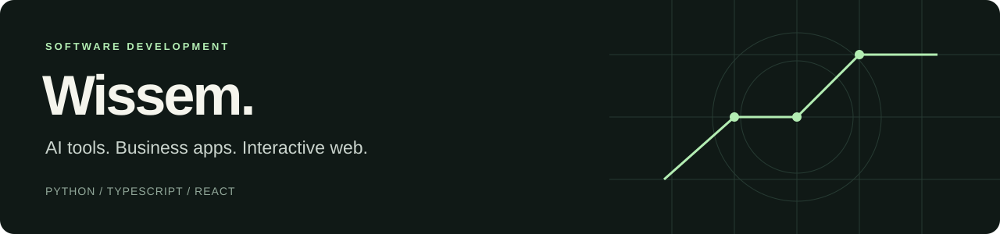

I build tools that connect software to everyday workflows: voice assistants in Python, business applications with Next.js and Supabase, and interactive web experiences.

**Core stack:** Python · TypeScript · React · Next.js · PostgreSQL / Supabase  
**Also in my projects:** MCP · speech processing · API integrations · GSAP · Three.js

### Start here

| Project | What to explore | Technical focus |
| :--- | :--- | :--- |
| **[Lowkey — voice assistant](https://github.com/Wissko/jarvis-assistant-vocal)** | A personal French/English assistant with local and cloud backends, an extensible tool registry and MCP integration. | Python, speech processing, tool execution, permissions |
| **[TBS Dashboard](https://github.com/Wissko/tbs-dashboard)** | A custom-order management application with authentication, tenant-scoped data, email workflows and Stripe Connect code. | Next.js, TypeScript, Supabase, SQL, server actions |
| **[AXION](https://github.com/Wissko/axion)** · [Demo](https://axion-orcin.vercel.app) | An editorial product showcase with client-rendered 3D models and animated sections. | React Three Fiber, Three.js, Framer Motion |
| **[Coffeeish](https://github.com/Wissko/coffeeish)** · [Demo](https://coffeeish.vercel.app) | A café website with scroll-driven SVG transitions, shared navigation and page animation. | Next.js, GSAP / ScrollTrigger, SVG, responsive UI |
| **[Fury Creation](https://github.com/Wissko/fury-creation-v2)** · [Demo](https://fury-creation-v2.vercel.app) | A miniature catalogue and cart prototype with a checkout interface and an order API stub. | React Context, local storage, TypeScript, API routes |

### A closer look at the code

- **Extensible tools:** Lowkey's [tool registry](https://github.com/Wissko/jarvis-assistant-vocal/blob/main/core/registre.py), [MCP entry point](https://github.com/Wissko/jarvis-assistant-vocal/blob/main/jarvis/mcp_server.py) and [focused unit tests](https://github.com/Wissko/jarvis-assistant-vocal/tree/main/tests).
- **Business logic and data access:** TBS Dashboard's [server actions](https://github.com/Wissko/tbs-dashboard/blob/main/app/actions/commandes.ts) and [database migrations](https://github.com/Wissko/tbs-dashboard/tree/main/supabase/migrations).
- **Interactive rendering:** AXION's [3D product component](https://github.com/Wissko/axion/blob/main/src/components/ProductCanvas.tsx) and Coffeeish's [scroll animation component](https://github.com/Wissko/coffeeish/blob/main/src/components/ScrollStage.tsx).

### About this portfolio

This is a selection of public projects and experiments. The project READMEs explain setup, implementation details and current limitations; a demo is not a claim of a production deployment or a client relationship.

French / English. Happy to discuss the implementation, tradeoffs and next steps behind these projects.
